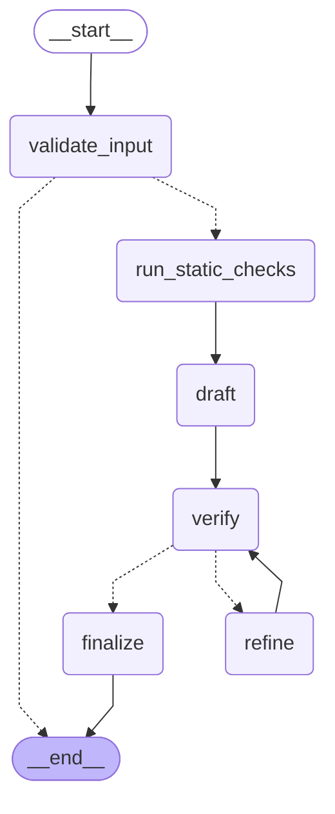

# devassist

A command-line assistant that documents and reviews Python snippets, checking every suggestion with static analysis.

You give it a snippet. It returns a summary, documentation, the issues it found and an improved version of the code. Before you see the improved code, `ast`, ruff and bandit check it, and the model fixes what they find, for at most 3 rounds. Claude Haiku 5.5 answers, with Claude Sonnet 5.5 as a fallback in round 3. Nothing ever runs the code you submit.

## Quickstart

You need [uv](https://docs.astral.sh/uv/), which installs Python 3.13 if you don't have it, and an Anthropic API key.

```
uv sync                                            # install the locked dependencies
cp .env.example .env                               # then set ANTHROPIC_API_KEY in .env
uv run devassist explain examples/find_users.py    # review the example snippet
```

These commands work the same in PowerShell and bash.

**Without uv**, use pip with Python 3.13:

```
python -m venv .venv
source .venv/bin/activate        # PowerShell: .venv\Scripts\Activate.ps1
pip install .
devassist explain examples/find_users.py
```

pip installs the newest compatible versions of the dependencies rather than the exact versions in `uv.lock`, which the tests ran against. CI installs this way on Linux for every pull request. **With Docker**, see [Docker](#docker) below.

## Sample output

A real run on [`examples/find_users.py`](examples/find_users.py), which has four planted problems: SQL injection, a mutable default argument, one query per name, and no docstring.

```
$ uv run devassist explain examples/find_users.py --trace
[trace] validate_input: input accepted
[trace] run_static_checks: 2 findings
[trace] draft: round 1 on claude-haiku-5-5, 1,638 in / 1,600 out tokens
[trace] verify: passed
[trace] finalize: done
1 round | 1,638 in / 1,600 out tokens | $0.000964 | 8.8 s
```

The trace and the summary line go to stderr. The review goes to stdout:

<details>
<summary>The review, as printed</summary>

~~~markdown
# Summary

Looks up each name in the users table of a SQLite database and returns the first matching row (id, name) for each name, or None where no row matches. The results are returned as a list in the same order as the input names.

## Documentation

##### `find_users(db, names=None)`

Fetches the `id` and `name` of users whose `name` matches each value in `names`.

**Parameters**

- `db` (`sqlite3.Connection`): An open SQLite connection that has a `users` table with `id` and `name` columns.
- `names` (`list[str] | None`, default `None`): The user names to look up. `None` is treated as an empty list.

**Returns**

A list with one entry per name, in input order. Each entry is a `(id, name)` tuple for the first matching row, or `None` if no row matches.

**Raises**

- `sqlite3.Error` (and subclasses such as `sqlite3.OperationalError`): If the query fails, for example because the `users` table does not exist.
- `TypeError`: If `names` is not iterable.

## Issues

- **high** security, line 7: The name is interpolated directly into the SQL string with an f-string. A name containing a single quote, such as `x' OR '1'='1`, changes the query and can read or modify data it should not reach. Use a parameterized query with a `?` placeholder and pass the value as a parameter, so the driver escapes it.
- **medium** bug, line 4: The default argument `names=[]` is a mutable list created once when the function is defined. The same list is shared by every call that omits `names`. Any code that mutates it would change later calls. Use `None` as the default and create a new list inside the function.

## Improved code

```python
import sqlite3
from typing import List, Optional


def find_users(db: sqlite3.Connection, names: Optional[List[str]] = None):
    if names is None:
        names = []
    results = []
    for name in names:
        query = "SELECT id, name FROM users WHERE name = ?"
        results.append(db.execute(query, (name,)).fetchone())
    return results
```
~~~

</details>

It caught and fixed the two problems that bandit and ruff also flagged, and the rewrite passed verification in one round. It missed the query per name and didn't list the missing docstring as an issue: the same two blind spots the eval found in Haiku (see [Results](#results-oct-18-2026)). The output above is unedited.

## Usage

Set up once as in the [Quickstart](#quickstart).

```
uv run devassist explain path/to/file.py                 # Markdown review
uv run devassist explain path/to/file.py --format json   # JSON, for scripts
cat path/to/file.py | uv run devassist explain           # read the snippet from stdin
uv run devassist --version
```

The review goes to stdout. Errors go to stderr, and so does a one-line run summary after a Markdown review: rounds, escalations, tokens, cost at list prices and time, such as `3 rounds (1 escalation) | 6,500 in / 3,000 out tokens | $0.0164 | 18.4 s`. JSON output carries the same numbers under `metrics`. A model missing from the price table in `config.py` shows its cost as unknown rather than wrong.

devassist writes UTF-8, so `> review.md` saves a clean UTF-8 review in most shells. Windows PowerShell 5.1 is the exception: it re-encodes text that passes through it, so `>` saves UTF-16 and can garble non-ASCII characters, and piped input loses them. On PowerShell 5.1, pass a file path rather than piping, and use PowerShell 7 when you need a saved review to be exact.

| Option | What it does |
|---|---|
| `--format markdown\|json` | How to print the review (default `markdown`). |
| `--model NAME` | Model for the rounds before escalation. Overrides `DEVASSIST_MODEL`. |
| `--max-rounds N` | Most model answers per run (default 3). Overrides `DEVASSIST_MAX_ROUNDS`. |
| `--language NAME` | The snippet's language. Only Python is supported. |
| `--verbose`, `-v` | Log escalations and retries to stderr. |
| `--trace` | Print each graph step to stderr as it finishes (see Tracing below). |

Settings come from command-line flags first, then environment variables, then `.env`, then the defaults in `.env.example`.

| Exit code | Meaning |
|---|---|
| 0 | Success, including a review with warnings. |
| 1 | An unexpected error (a bug). |
| 2 | A usage or input problem: missing, unreadable, non-UTF-8, empty or oversized input, or another language. |
| 3 | A configuration problem, such as a missing API key or an invalid setting. |
| 4 | A model or API problem: timeout, rate limit, refusal, or an answer that failed validation twice. |
| 5 | A static analyzer failed. |

### Docker

For a machine without uv, build the image once, then run it from the folder that holds your code:

```
docker build -t devassist .
docker run --rm -e ANTHROPIC_API_KEY -v "${PWD}:/work:ro" devassist explain /work/path/to/file.py
```

- `-e ANTHROPIC_API_KEY` passes the key from your shell into the container. The key is never built into the image. Set it in your shell first, or keep it in a `.env` file in the shared folder.
- `-v "${PWD}:/work:ro"` shares the current folder with the container as `/work`, read-only, so devassist can read your code but not change it. Paths you pass start with `/work/`.
- The command is the same in PowerShell and bash. Sharing a folder works better than piping code in, because Windows PowerShell 5.1 pipes text as ASCII.
- The container runs as a non-root user. LangSmith tracing stays off unless you pass its variables with `-e` as well.

CI builds the image and runs this command on Linux for every pull request (see `docs/decisions.md` D17). It hasn't been run on Docker Desktop for Windows.

## How it works

devassist runs as a LangGraph graph. Solid arrows always run; dashed arrows are routes chosen at run time. The diagram is generated from the compiled graph (`mermaid_diagram` in `agent.py`), and a test fails if this copy falls out of date.



1. **`validate_input`** rejects empty, oversized, non-Python and too deeply nested input, before any analyzer or model runs.
2. **`run_static_checks`** runs `ast`, ruff and bandit on the snippet. Their findings go into the prompt.
3. **`draft`** asks the model for a summary, documentation, issues and improved code, as structured output validated with Pydantic. An invalid answer is retried once with the errors fed back.
4. **`verify`** checks the improved code: it must parse, add no new ruff or bandit findings, and keep the original's public functions, classes and methods with the same parameters.
5. **`refine`** sends the problems back to the model for another round. Rounds 1 and 2 use Haiku; round 3 uses Sonnet.
6. **`finalize`** returns the answer after a pass, or after the last round with the remaining problems as warnings.

The analyzers run as subprocesses on a temporary copy of the snippet, with timeouts and no shell. The code is read, never executed (`docs/decisions.md` D5).

## Tracing

`--trace` prints each step of the graph to stderr as it finishes. It shows counts, rounds, models and problems, never code:

```
[trace] validate_input: input accepted
[trace] run_static_checks: 3 findings
[trace] draft: round 1 on claude-haiku-5-5, 1,900 in / 1,200 out tokens
[trace] verify: 1 problem
[trace]   - public function `add` changed from (a, b) to (x, y)
[trace] refine: round 2 on claude-haiku-5-5, 2,400 in / 1,300 out tokens
[trace] verify: passed
[trace] finalize: done
```

**LangSmith (optional).** LangGraph can also record every run in [LangSmith](https://smith.langchain.com), LangChain's hosted tracing service. It stays off unless you set LangSmith's own variables in your shell:

```
LANGSMITH_TRACING=true
LANGSMITH_API_KEY=<your LangSmith key>
```

**Traces send the snippet, the analyzer findings and the model's answers to LangSmith's servers.** devassist prints a notice on stderr whenever tracing is on, and a warning if tracing is requested without a key. The Anthropic API key never appears in a trace. LangSmith reads these variables from the shell only; setting them in `.env` has no effect (see `docs/decisions.md` D15).

## Evaluation

The eval in `evals/` measures review quality on 30 labeled cases: 18 with a planted issue, 8 clean controls and 4 adversarial inputs. It compares the shipped design (Haiku, with Sonnet in round 3) with Haiku alone and Sonnet alone, and judges the design against a bar set before any results existed (`docs/decisions.md` D8 and D16). Runs are scored by rule, with no human or model judging.

```
uv run python -m evals.run_evals --dry-run   # estimated cost, no API calls
uv run python -m evals.run_evals --smoke     # the 12 smoke cases
uv run python -m evals.run_evals             # all 30 cases, 3 runs each
```

Every run except `--dry-run` calls the Anthropic API and costs money; the full eval costs about $1 to $3. Results go to `evals/results/`: each run's raw record (`<label>-runs.jsonl`), the summary with the bar's verdict (`<label>-summary.json`) and a table with one row per case (`<label>-cases.csv`). The eval never runs in CI.

### Results (Oct 18, 2026)

Each configuration reviewed the 30 cases 3 times: 270 runs, $1.14 in all. The raw data is in `evals/results/`.

| | Recall | False alarms | Cost per snippet | p50 latency | p95 latency |
|---|---|---|---|---|---|
| Design (Haiku, Sonnet in round 3) | 92.6% | 8.3% | $0.00090 | 6.9 s | 13.3 s |
| Haiku alone | 88.9% | 20.8% | $0.00089 | 7.0 s | 11.6 s |
| Sonnet alone | 94.4% | 0.0% | $0.01176 | 5.7 s | 12.4 s |

In every configuration, every answer was valid on the first try, every final rewrite passed verification, every adversarial case passed in every run, and no run failed.

**Verdict against the bar (D8): the design stays.** It costs 7.7% as much as Sonnet alone, about 13 times less, with a p95 latency of 13.3 seconds. Recall (−1.9 points against Sonnet alone, 95% CI −11.1 to +5.6) and false alarms (+8.3 points, 95% CI 0 to +20.8) pass on their point estimates but are inconclusive: their intervals contain the 10-point margin, so 30 cases can't rule out a real gap.

What to keep in mind:

- **The fallback never fired.** Every rewrite passed verification within two Haiku rounds; 6 of the 168 Haiku runs that reached the model needed the second. The eval shows Haiku is enough for these cases. It doesn't measure what Sonnet adds on harder ones.
- **The design and Haiku alone ran the same thing twice.** They are identical until round 3, so the gaps between them (3.7 points of recall, 12.5 points of false alarms) are run-to-run noise. That noise is as large as the margins, which is why two criteria are inconclusive.
- **Most misses come from two cases.** In `performance-query-per-item`, every configuration, Sonnet included, reported a real bug the case didn't plant (`SUM` returns NULL for an order with no items) and mostly skipped the planted N+1 query. In `documentation-missing-docstring`, Sonnet flagged the missing docstring in all 3 runs and Haiku in 1 of 6. All 8 near misses were a different real bug on overlapping lines, not the planted issue filed under another category. The answer key stays as it was, since changing it after seeing results would undo the point of setting the bar first.
- **Every false alarm was low severity.** This view is exploratory, not part of the bar: a `Raises` section missing an exception, or a symlink race in a path check that is arguably a fair point. Counting only medium and high issues, every configuration's false-alarm rate is 0%.

## Frameworks used and skipped

| Used | For | Why |
|---|---|---|
| LangGraph | Orchestration only | The routing is explicit and each route is testable. It streams steps for `--trace` and draws the diagram above. |
| Anthropic SDK, called directly | Model calls, behind the `LLMClient` protocol | Native structured output and exact token counts for cost, with no wrapper layer to debug. Tests use a fake client. |
| Pydantic, pydantic-settings | The output schema, validation, settings | One model is both the schema sent to the API and the validator for its answer. |
| Typer | The CLI | Arguments are validated and `--help` is generated from type hints. |
| `ast`, ruff, bandit | Verifying every rewrite | Static only: they read the code without running it. |
| LangSmith | Optional tracing | Off by default, because traces send code to a third party. |

| Skipped | Why |
|---|---|
| LangChain chat-model wrappers and `create_agent` | An agent lets the model choose which tools to call, but here the checks must run every time (D3, D4). |
| The Claude Agent SDK | Its strength is running commands and editing files, which must never happen with submitted code (D3). |
| OpenAI and Google clients | Cut for time; the eval compares Anthropic configurations only (D9). |
| numpy for the eval's statistics | A standard-library bootstrap takes about a second at 30 cases. |
| An MCP server | A stretch goal that didn't fit the schedule. |

## Limitations

- **Verification is static.** Every rewrite must parse, add no new ruff or bandit findings, and keep the original's public functions, classes and methods with the same parameters. Those checks can't tell whether a change is *correct*. When devassist reviewed its own code, Haiku "fixed" a correct import, changing `httpx2` to `httpx` because its knowledge of the Anthropic SDK was out of date, and the rewrite passed every check. Read the improved code before you use it.
- **Python only**, up to 20,000 characters (see `docs/decisions.md` D12).
- **Cost grows with the snippet, not the fix.** The improved code is always the complete snippet, so a one-line fix to a long file still pays for the whole file in output tokens, the expensive kind. Reviewing a 150-line module costs about a third of a cent with Haiku.

## With more time

1. **Measure the rival models**, starting with GPT-6 Luna, which is priced like Haiku (D9).
2. **More cases, especially clean controls.** With 8, one case flagged in all 3 runs moves the false-alarm rate by 12.5 points, more than the 10-point margin.
3. **Cases hard enough to make the fallback fire**, to measure what Sonnet in round 3 adds.
4. **Planted cases with nothing else wrong.** One snippet had a real bug nobody planted, and it drew attention away from the planted issue.
5. **Keep each round's verify problems** in the eval's records. Today only the final warnings are saved.
6. **Grade summaries and documentation** with a judge model, checked against human grades.
7. **Run the Docker image and the pip install on Windows.** CI covers both on Linux only.
8. **An MCP server** exposing one `explain_snippet` tool, as thin an adapter as `cli.py`.

## How AI was used

I built devassist with Claude Code (Claude Opus 5.5) as a pair programmer. I set the requirements, the decisions in `docs/decisions.md` and the eval's bar before any results existed. Claude Code proposed a plan for each change and waited for my approval, wrote the failing tests first, then the code and docs, and ran the checks. Every change went through a pull request that merged only after CI passed on Linux and Windows. Commits made with Claude Code carry its `Co-Authored-By` line, and the rules it worked under are in `CLAUDE.md`.

## Development

- Install: `uv sync`, then `uv run pre-commit install` to turn on the git hooks.
- Run every check: `uv run pre-commit run --all-files`.
- Tests run offline with a fake model client: `uv run pytest`. Tests that call the real API: `uv run pytest -m live --no-cov`.
- When the graph changes, `tests/test_readme.py` fails and prints the new Mermaid diagram to paste into this README.

`main` is guarded by a pre-commit hook and by habit rather than GitHub branch protection, which this private repo's plan doesn't include. The `no-commit-to-branch` hook refuses commits to `main`, and pull requests merge only after CI passes.
