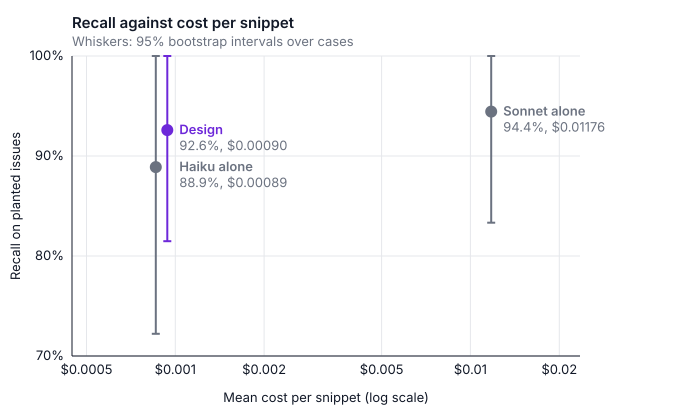

# Evaluation

The eval in `evals/` measures review quality on 30 labeled cases: 18 with a planted issue, 8 clean controls and 4 adversarial inputs. It compares the design with Haiku alone and Sonnet alone, and judges the design against a bar set before any results existed (`docs/decisions.md` D8 and D16). Runs are scored by rule, with no human or model judging. It has run three times: on the shipped design (Haiku, with Sonnet in round 3); with the optional second review added to it (D18), which is how the runner's design configuration now stands; and on D19's short-lived workflow, which D20 reverted.

## Running the eval

```
uv run python -m evals.run_evals --dry-run             # estimated cost, no API calls
uv run python -m evals.run_evals --smoke               # the 12 smoke cases
uv run python -m evals.run_evals                       # all 30 cases, 3 runs each
uv run python -m evals.run_evals --label with-review   # name the result files
```

Every run except `--dry-run` calls the Anthropic API and costs money; the full eval costs about $1 to $3. Results go to `evals/results/`: each run's raw record (`<label>-runs.jsonl`), the summary with the bar's verdict (`<label>-summary.json`) and a table with one row per case (`<label>-cases.csv`). The label is `smoke` or `full` unless `--label` sets it. The eval never runs in CI.

## Results (Oct 18, 2026)

Each configuration reviewed the 30 cases 3 times: 270 runs, $1.14 in all. The raw data is in `evals/results/`.

| | Recall | False alarms | Cost per snippet | p50 latency | p95 latency |
|---|---|---|---|---|---|
| Design (Haiku, Sonnet in round 3) | 92.6% | 8.3% | $0.00090 | 6.9 s | 13.3 s |
| Haiku alone | 88.9% | 20.8% | $0.00089 | 7.0 s | 11.6 s |
| Sonnet alone | 94.4% | 0.0% | $0.01176 | 5.7 s | 12.4 s |

In every configuration, every answer was valid on the first try, every final rewrite passed verification, every adversarial case passed in every run, and no run failed.

**Verdict against the bar (D8): the design stays.** It costs 7.7% as much as Sonnet alone, about 13 times less, with a p95 latency of 13.3 seconds. Recall (−1.9 points against Sonnet alone, 95% CI −11.1 to +5.6) and false alarms (+8.3 points, 95% CI 0 to +20.8) pass on their point estimates but are inconclusive: their intervals contain the 10-point margin, so 30 cases can't rule out a real gap.

What to keep in mind:

- **The fallback never fired.** Every rewrite passed verification within two Haiku rounds; 6 of the 168 Haiku runs that reached the model needed the second. The eval shows Haiku is enough for these cases. It doesn't measure what Sonnet adds on harder ones.
- **The design and Haiku alone ran the same thing twice.** They are identical until round 3, so the gaps between them (3.7 points of recall, 12.5 points of false alarms) are run-to-run noise. That noise is as large as the margins, which is why two criteria are inconclusive.
- **Most misses come from two cases.** In `performance-query-per-item`, every configuration, Sonnet included, reported a real bug the case didn't plant (`SUM` returns NULL for an order with no items) and mostly skipped the planted N+1 query. In `documentation-missing-docstring`, Sonnet flagged the missing docstring in all 3 runs and Haiku in 1 of 6. All 8 near misses were a different real bug on overlapping lines, not the planted issue filed under another category. The answer key stays as it was, since changing it after seeing results would undo the point of setting the bar first.
- **Every false alarm was low severity.** This view is exploratory, not part of the bar: a `Raises` section missing an exception, or a symlink race in a path check that is arguably a fair point. Counting only medium and high issues, every configuration's false-alarm rate is 0%.
- **A second measurement put Haiku's false alarms higher.** The [second-review eval](#second-review-oct-18-2026) ran Haiku's drafts again. Across both evals, Haiku's false-alarm rate came out at 8.3%, 20.8%, 20.8% and 25.0%: 18 of 96 clean runs pooled, against Sonnet alone's 0 of 48. The design's 8.3% above was the low draw, so as strictly defined, counting any severity, the false-alarm criterion more likely fails than passes. Every one of those false alarms was low severity again, and 10 of the 18 came from one case, `clean-safe-upload-path`, where Haiku says the docstring's `Raises` section leaves out errors such as `PermissionError`. Recall replicated: 88.9% for Haiku alone and 94.4% for Sonnet alone, both times.

## Second review (Oct 18, 2026)

The second eval measured the optional review (`--review`, D18). The design ran with Sonnet checking each passing answer for missed issues; Haiku alone and Sonnet alone stayed single-pass, so Haiku alone shows what the review adds. 270 runs, $1.67, in `evals/results/with-review-*`.

| | Recall | False alarms | Cost per snippet | p50 latency | p95 latency |
|---|---|---|---|---|---|
| Design with the review | 100.0% | 20.8% | $0.00738 | 9.2 s | 39.5 s |
| Haiku alone | 88.9% | 25.0% | $0.00086 | 6.7 s | 14.7 s |
| Sonnet alone | 94.4% | 0.0% | $0.01164 | 5.6 s | 13.8 s |

**Verdict (D18): the review stays off by default.** It meets three of D8's criteria and misses three on their point estimates: false alarms (+20.8 points against Sonnet alone, 95% CI +4.2 to +45.8), p95 latency (39.5 s against a 30-second limit) and cost (63% of Sonnet alone's, 95% CI 49% to 86%, against a 50% limit). Under the rule set before the run, it ships off by default, behind `--review`.

What it bought, and what it cost:

- **It found what the single passes missed.** Recall reached 100%, against 88.9% for Haiku alone and 94.4% for Sonnet alone. It found the N+1 query in 3 of 3 runs, which Haiku alone and Sonnet alone each found in none, and the missing docstring in 3 of 3, against Haiku alone's 0 of 3.
- **It raised no false alarms of its own.** The review flagged missed issues in 19 of 54 planted runs and in none of the 24 clean runs. Every false alarm in the design came from Haiku's first draft. The review can only add issues, so it couldn't remove those either.
- **It's expensive when it finds something.** The 65 runs where it found nothing cost $0.0048 on average and took 8.6 s. The 19 where it found missed issues cost $0.0162, more than Sonnet alone, and took 27.5 s, because a Sonnet call is followed by a full Haiku rewrite. In 4 of them that rewrite failed verification, so Sonnet answered a third round: the fallback's first use in either eval. Those 4 runs cost about $0.04 each and took 40 to 51 seconds. The 19 flagged runs are 23% of the total, more than the slowest 5%, so they alone decide the p95 latency.
- **The same caveats as D18.** The reviewer's checklist was written after the first eval showed which issues Haiku missed, so the gains on those cases are partly in-sample. Each case plants one issue, so the eval barely tests snippets with many problems, where a second review should matter most.

## Third eval: Sonnet making the fix (Oct 19, 2026)

D19 briefly made the review the default, had Sonnet rather than Haiku add and fix what it found, and gave each model 2 tries. A third eval measured that workflow: 270 runs, $2.14, in `evals/results/workflow-d19-*`.

| | Recall | False alarms | Cost per snippet | p50 latency | p95 latency |
|---|---|---|---|---|---|
| D19 workflow | 96.3% | 12.5% | $0.01204 | 10.1 s | 44.9 s |
| Haiku alone | 88.9% | 4.2% | $0.00087 | 7.9 s | 14.8 s |
| Sonnet alone | 98.1% | 4.2% | $0.01252 | 7.6 s | 20.1 s |

**Verdict (D20): reverted.** The workflow cost 96% of Sonnet alone's per snippet (95% CI 70% to 120%), took twice as long at p95, and was no better on recall or false alarms. Sonnet alone dominated it, so devassist went back to D18's workflow: the review off by default, and Haiku making the fix under `--review`.

- **Sonnet's fix was the expensive part.** The 22 runs whose review flagged something averaged $0.033 and 30 s, almost 3 times Sonnet alone's cost, because a Sonnet review was followed by a full Sonnet rewrite.
- **The fix dropped some of the review's findings.** In the N+1 case, the review found the planted query in all 3 runs, but Sonnet's final answer kept it in only 1. The fixing model is asked to keep what the review found, and doesn't always.
- **Haiku's false alarms swung again,** to 4.2%, after 8.3% to 25% in the first two evals, and Sonnet alone raised its first, both on the same arguably fair point in `clean-safe-upload-path`. With 8 clean cases, each flagged run moves the rate by 4.2 points.

## Why Haiku



The design reviews a snippet for $0.00090 against Sonnet alone's $0.01176, with recall 1.9 points lower and overlapping intervals. The price is noise: on clean code, Haiku reports low-severity documentation points that Sonnet doesn't (see the second measurement above). At 1,000 snippets a day, that's $0.90 a day (about $27 a month) against $11.76 a day (about $353 a month). The chart is drawn from `evals/results/full-runs.jsonl` by `uv run python -m evals.chart`.

- **13 times cheaper, not 20.** Haiku's list prices are a twentieth of Sonnet's, but its answers ran about 1.7 times longer (about 1,460 output tokens against 853), and output tokens are the expensive kind.
- **The fallback fired in 0 of 84 design runs** that reached the model. For now it's insurance that costs nothing until a rewrite fails verification twice.
- **What would make me switch:**
  - To escalating in round 2, D8's first change to try, if a larger eval put recall more than 10 points below Sonnet alone's, or false alarms more than 10 points above.
  - To Sonnet in every round, if reviewing documentation mattered most: it flagged the missing docstring in every run, Haiku in 1 of 6.
  - To Sonnet in every round, if any reported issue blocked something, such as a CI gate that fails a build on any finding. Sonnet raised one false alarm in three evals, against Haiku's 4% to 25%, and there noise would cost more than tokens. `--model claude-sonnet-5-5` does this per run today.
  - Reopening the choice, if prices moved so the design cost more than half as much as Sonnet alone.
- **`--review` or Sonnet alone, for a more thorough review?** `--review` found the most planted issues, 100% in D18's eval, at about 63% of Sonnet alone's cost, but with more false alarms and a p95 of 39.5 s. `--model claude-sonnet-5-5` is quieter and simpler, with one low-severity false alarm in three evals and a p95 under 21 s, at about 13 times Haiku's cost.
- **Rival models were priced, not measured** (D9):

| Model | Input ($ per million tokens) | Output ($ per million tokens) |
|---|---|---|
| [Claude Haiku 5.5](https://platform.claude.com/docs/en/about-claude/pricing) | 0.10 | 0.50 |
| [GPT-6 Luna](https://developers.openai.com/api/docs/pricing) | 0.10 | 0.50 |
| [Gemini 3.5 Flash-Lite](https://ai.google.dev/gemini-api/docs/pricing) | 0.30 | 2.50 |
| [Claude Sonnet 5.5](https://platform.claude.com/docs/en/about-claude/pricing) | 2.00 | 10.00 |

List prices checked Oct 13, 2026. Tokenizers differ between providers, so the same snippet comes to a different number of tokens on each, and equal prices per token don't mean equal cost per snippet. Only measuring the rivals would settle it.

## Improving the eval

1. **Multi-issue cases, with one-to-one matching** of reported to expected issues, to measure the review on the snippets where it should matter most.
2. **More cases, especially clean controls.** With 8, one case flagged in all 3 runs moves the false-alarm rate by 12.5 points, more than the 10-point margin.
3. **Cases hard enough to make the fallback fire on the first pass**, to measure what Sonnet in round 3 adds without the review.
4. **Planted cases with nothing else wrong.** One snippet had a real bug nobody planted, and it drew attention away from the planted issue.
5. **Keep each round's answer and verify problems** in the eval's records, so the eval can say exactly which issues the review added. Today only the final answer and warnings are saved.
6. **Grade summaries and documentation** with a judge model, checked against human grades.
